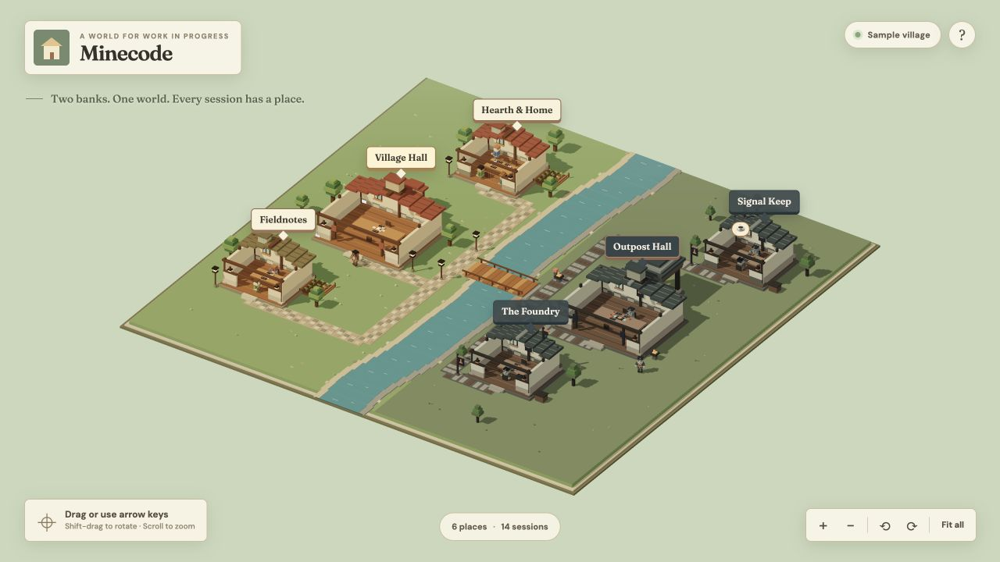

# Minecode

A navigable, blocky world for Claude Code and Codex sessions. Claude's workshops and Codex's outposts face each other across a river. Sessions have places at shared worktables; characters type, take coffee breaks, and sometimes step outside. Sessions without a project gather in the Village Hall or Outpost Hall.



The world fills the browser viewport. Drag or use the arrow keys to pan, Shift-drag or right-drag to rotate and tilt, and scroll or pinch to zoom. Select a building name to focus it, and select a character to inspect its session. A straight path from each bridge end reaches a paved landing with an outdoor telemetry board before branching toward the buildings. Select a board to open that agent's usage dashboard in a panel occupying 75% of the screen on desktop. The panel offers 7, 30, and 90 day or all-time totals and a cumulative token chart; it refreshes every 15 seconds. The map controls rotate, zoom, and fit the whole village. Keyboard shortcuts: arrow keys to pan, `0` to fit all, `Q` and `E` to rotate, and `Escape` to close the details panel. A coffee badge appears above a character while they take a sip.

## Try it

Requires Node.js 20.19 or newer.

```sh
npm install
VILLAGE_SOURCE=sample npm run dev
```

Open <http://127.0.0.1:5177>. Sample mode uses fictional session data for the world; its telemetry boards show locally collected usage. The development command starts Vite and Minecode's API and telemetry receivers together. For a built version, run `npm start` and open <http://127.0.0.1:41321>.

## Use live sessions

Stop the two telemetry dashboard servers before starting Minecode, because Minecode takes over their OTLP ports. Start Minecode with `npm run dev` (without `VILLAGE_SOURCE=sample`). It receives and stores the same OTLP streams itself:

| Source | Minecode receiver |
| --- | --- |
| Claude Code | `http://127.0.0.1:4318/v1/metrics` and `/v1/logs` |
| Codex | `http://127.0.0.1:18766/v1/logs` |

The existing Claude Code and Codex exporter settings can keep those endpoints. Minecode stores data in Git-ignored `data/claude.sqlite3` and `data/codex.sqlite3`. On its first start, it imports history from the sibling dashboard databases if they exist. It does not need those repos afterward. Set `VILLAGE_DATA_DIR` to move its storage, `CLAUDE_OTLP_PORT` or `CODEX_OTLP_PORT` to change receiver ports, and `VILLAGE_PORT` to change the web port. All listeners bind to loopback. Vite uses `127.0.0.1:5177` during development.

The default view shows sessions observed in the last 48 hours. The time control offers 24 hours, 7 days, and 30 days, and the browser refreshes every 15 seconds. A new store starts empty until its first OTLP event arrives. Use `VILLAGE_SOURCE=sample` for a fictional world.

Claude telemetry provides project IDs, and Minecode scans local Claude metadata for custom chat titles. Codex telemetry provides session IDs and activity; Minecode uses local Codex metadata when available to recover titles and project folders. Projectless Claude sessions gather in **Village Hall**. Codex's dated chat folders and sessions without project metadata gather in **Outpost Hall**. Recent activity is an observed signal, not proof that a session is still running.

### Local data boundary

The sample world and preview image contain fictional sessions; no live telemetry snapshots are tracked by Git. At runtime, Minecode's world API sends only names, IDs, timestamps, and short generic activity labels to the browser. The telemetry board API sends aggregated counts, cost estimates where available, and a bounded token timeline. Neither API returns prompts, transcripts, tool inputs, or credentials. The local databases contain received telemetry, including sanitized prompt text where available, so protect or delete them as you would the old dashboard databases. Names, IDs, and usage totals from your own sessions may still be private. Keep Minecode on loopback and use sample mode for public screenshots.

## Use a standalone data file

Minecode can also read a JSON snapshot from an absolute path. `VILLAGE_DATA_FILE` takes precedence over automatic telemetry. The server validates its public fields on each `GET /api/world` request, so a collector can replace the file atomically without restarting the app.

```sh
VILLAGE_DATA_FILE=/absolute/path/to/world.json npm run dev
```

```json
{
  "projects": [
    {
      "id": "project-id",
      "name": "Project name",
      "kind": "Workshop",
      "source": "claude",
      "sessions": [
        {
          "id": "session-id",
          "name": "Session name",
          "updatedAt": "2026-01-01T12:00:00Z",
          "activity": "Latest observed activity",
          "status": "recent"
        }
      ]
    }
  ]
}
```

`source` is `claude` or `codex` and places the building on its corresponding bank; omitting it defaults to `claude`. Use `kind: "Commons"` for a communal hall. `updatedAt` may be `null`. `status` is `recent`, `quiet`, or `unknown`; it describes a supplied signal, not whether a process is running. Project and session IDs must be unique.

## Development

```sh
npm test
npm run build
```

Opening or continuing an agent conversation from the world is future work. Cowork is not connected. The initial camera and seated character concepts were adapted from an earlier Office prototype; the village layout, architecture, styling, data boundary, and interface live in this standalone repository.
